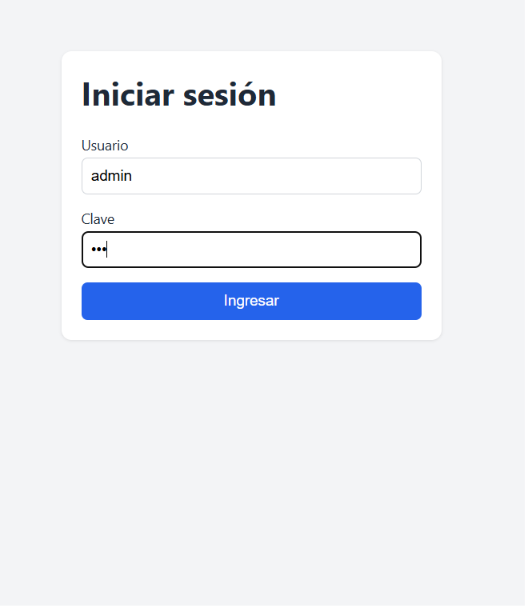
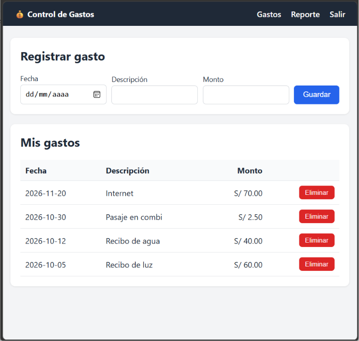
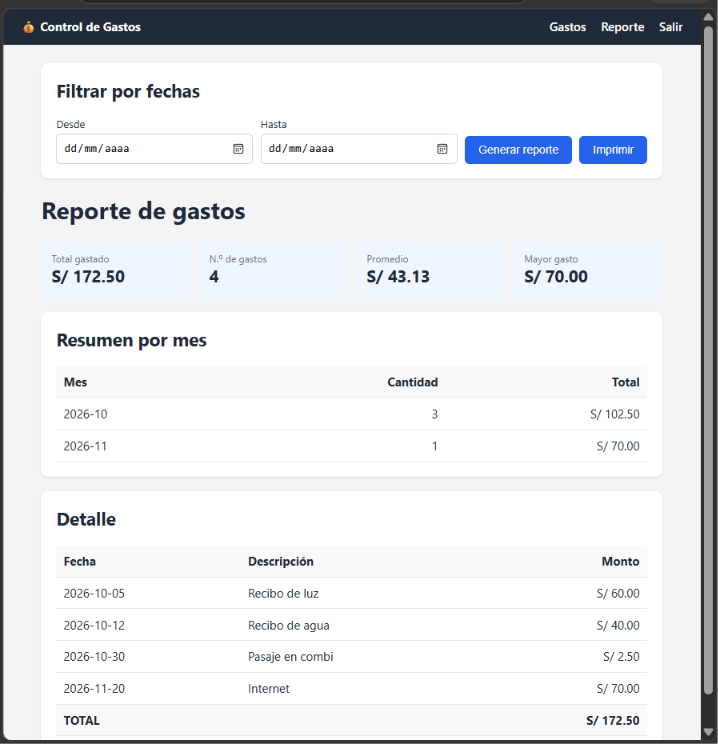

# Control de Gastos

Página web para registrar gastos (fecha, descripción y monto) y generar un reporte.

**Usuario:** admin  **Clave:** 123

## Funcionamiento
1. Se inicia sesión con las credenciales.
2. En "Gastos" se registran y eliminan gastos.
3. En "Reporte" se ve el total, el promedio, el resumen por mes y el detalle, con filtro por fechas.

## Capturas

